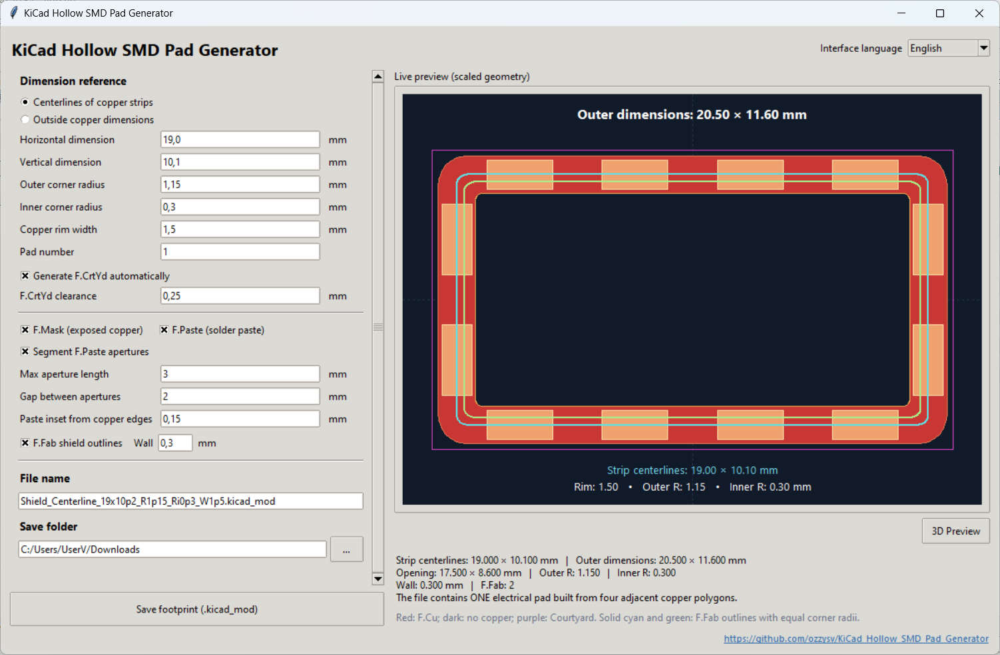
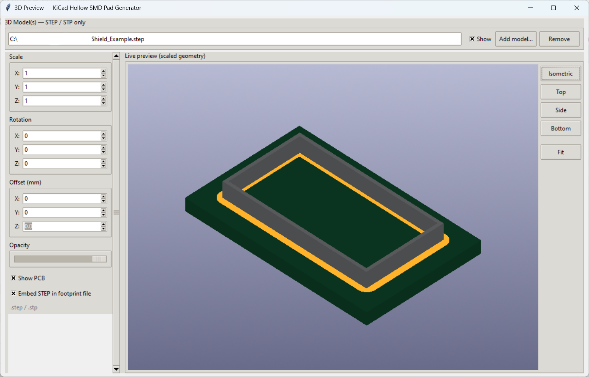
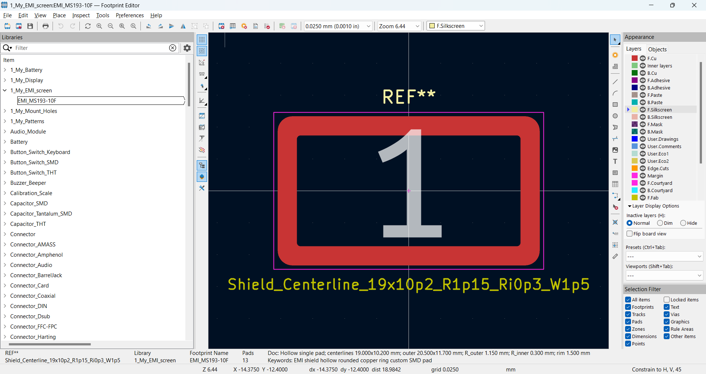
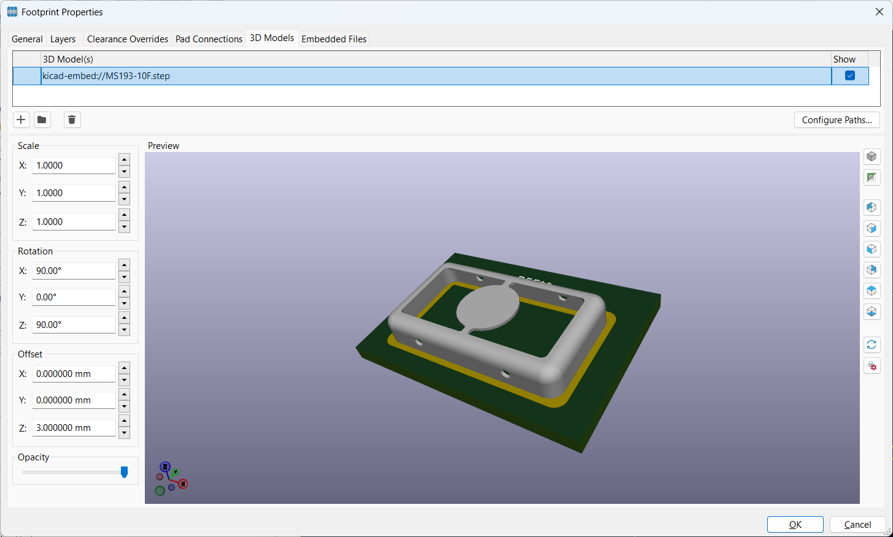

KiCad Hollow SMD Pad Generator

A Python GUI tool for creating hollow, rounded-rectangle SMD footprints for KiCad, particularly for EMI/RFI shielding cans. Customize dimensions, corner radii, copper rim width, and shield wall thickness. The tool supports segmented `F.Paste` apertures, `F.Fab` outlines, automatic `F.CrtYd`, STEP/STP model preview and embedding, and `.kicad_mod` export.

### Main window
Set footprint dimensions and options with a live 2D preview.



### 3D preview
Load a STEP/STP model, inspect its placement on the pad, and adjust orientation and offset.



### Generated footprint in KiCad
The hollow SMD pad opened in the KiCad Footprint Editor.



### 3D model in KiCad
The STEP model embedded in the footprint and displayed in KiCad's 3D preview.



## Requirements

- Python 3.12 or newer
- Tkinter (included with standard Python installations)

Install the required libraries for 3D Preview and STEP model support:

```bash
python -m pip install cadquery-ocp vtk zstandard
```

## Quick Installation

1. Download or clone the repository:

   ```bash
   git clone https://github.com/ozzysv/KiCad_Hollow_SMD_Pad_Generator.git
   ```

2. Open the project directory:

   ```bash
   cd KiCad_Hollow_SMD_Pad_Generator
   ```

3. Install the dependencies:

   ```bash
   python -m pip install cadquery-ocp vtk zstandard
   ```

4. Run the application:

   ```bash
   python KiCad_Hollow_SMD_Pad_Generator.py
   ```

The 2D footprint generator works without the additional 3D libraries.
